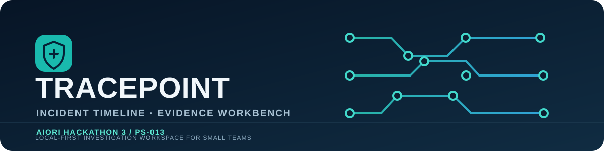
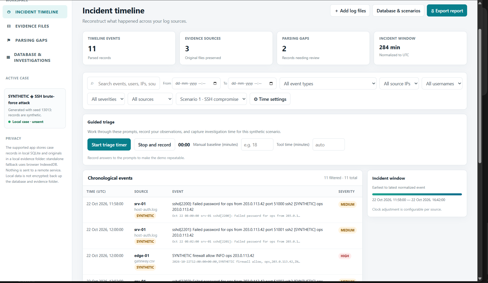
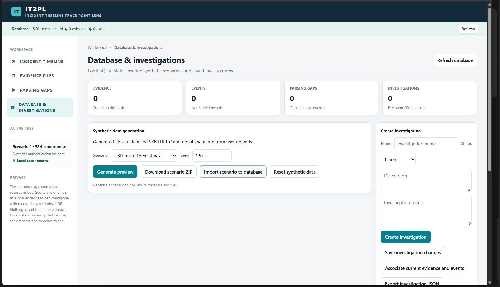
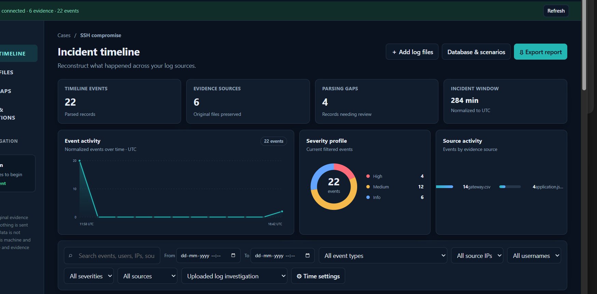
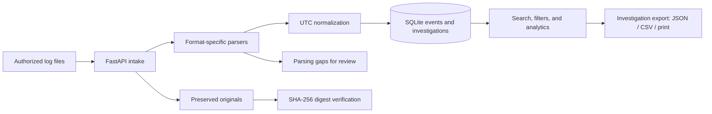

<p align="center">
  
</p>

<h1 align="center">Tracepoint</h1>
<p align="center"><strong>Incident Timeline & Evidence Collection for Small Teams</strong></p>
<p align="center">AIORI Hackathon 3 · PS-013 · Team A3-PS013-TC015 · Arise</p>

<p align="center">
  <a href="#quick-start">Quick start</a> ·
  <a href="#analyst-workflow">Analyst workflow</a> ·
  <a href="#team-demo">Team demo</a> ·
  <a href="#architecture">Architecture</a> ·
  <a href="#security-and-limitations">Security and limitations</a>
</p>

Tracepoint helps a small security team reconstruct an incident from scattered host, application, web, and network logs. It preserves uploaded originals, records SHA-256 digests, normalizes supported timestamps to UTC, and turns parseable records into a searchable timeline. Analysts can review parsing gaps, document an investigation, and export a report.

> **Scope:** Tracepoint is a local-first investigation workbench for authorized logs. It is not a SIEM, live endpoint agent, automated threat verdict, or forensic certification product. Findings are rule-based review cues; analysts must validate them against the original records.

## At a glance

| | |
|---|---|
| **Problem statement** | PS-013 — Incident Timeline and Evidence Collection for Small Teams |
| **Team** | Arise · A3-PS013-TC015 |
| **Application** | Browser interface backed by FastAPI and SQLite |
| **Core workflow** | Collect → preserve → normalize → investigate → report |
| **Data handling** | Local machine storage; no remote service required by the app |
| **Synthetic coverage** | SSH brute force, web application attack, suspicious network activity |

## Tracepoint workspace

The dashboard brings the incident window, event counts, evidence sources, parsing gaps, and event analytics together. The screenshots below are from the project interface; synthetic records are labeled as synthetic in the application.

<p align="center">
  
</p>
<p align="center"><sub>Incident timeline · search and filter normalized records, compare sources, and review the incident window.</sub></p>

<p align="center">
  
</p>
<p align="center"><sub>Database and investigations · create an investigation, generate or import a scenario, and export investigation data.</sub></p>

<p align="center">
  
</p>
<p align="center"><sub>Parsing gaps and findings · inspect records that need review and treat heuristics as leads, not proof.</sub></p>

## What it does

| Capability | How it supports an investigation |
|---|---|
| **Evidence intake** | Uploads supported log files and records source metadata, timezone, and optional clock correction. |
| **Original preservation** | Keeps original file bytes apart from parsed records and calculates a SHA-256 digest at intake. |
| **Time normalization** | Converts supported timestamps to UTC while retaining the original timestamp text and source context. |
| **Timeline and analytics** | Searches and filters normalized events; charts show activity over time, severity, and evidence-source counts. |
| **Parsing-gap review** | Retains unnormalized source rows with a line reference and reason so an analyst can inspect them. |
| **Investigation notes** | Saves status, description, notes, triage timing, and links to selected evidence and events. |
| **Report export** | Exports investigation details as JSON or CSV and supports printing a report to PDF from the browser. |
| **Theme support** | Offers light and dark themes with a remembered preference. |

## Analyst workflow

1. **Choose a case.** Open the incident timeline or create an investigation to organize the work.
2. **Add evidence.** Upload logs you are authorized to examine, or use a clearly labeled synthetic scenario to explore the workflow.
3. **Check preservation details.** Review each source file and its saved SHA-256 digest. Verification detects changes relative to that digest; it does not prove who collected the file or where it came from.
4. **Reconstruct the timeline.** Filter by time, source, event type, severity, IP, username, or search text. Compare original records with normalized UTC events.
5. **Review gaps and findings.** Inspect malformed or unsupported rows and validate rule-based observations against source context.
6. **Document and report.** Save investigation notes and triage time, associate relevant evidence/events, then export JSON/CSV or print to PDF.

## Quick start

### Windows PowerShell

Open a terminal in the repository root and run:

```powershell
py -3 -m venv backend\.venv
backend\.venv\Scripts\python.exe -m pip install -r backend\requirements.txt
backend\.venv\Scripts\python.exe -m uvicorn app.main:app --app-dir backend --host 127.0.0.1 --port 8000
```

Then open [http://127.0.0.1:8000](http://127.0.0.1:8000). Keep the terminal running while using the app. Press **Ctrl+C** to stop the server. If port 8000 is already in use, replace `--port 8000` with `--port 8001` and open `http://127.0.0.1:8001`.

Python 3.11 or newer is recommended. The frontend is served by the backend, so no separate frontend build command is needed. Interactive API documentation is at `/docs` while the server is running.

## Supported evidence

The current parsers cover common examples of:

- Linux authentication logs
- Apache and Nginx access logs
- CSV event records
- JSON and JSON Lines (`.jsonl`)
- Firewall key/value records
- Narrow timestamped plain-text formats

The upload limit is 25 MiB per file. Parser support is format-specific: an unfamiliar variant, malformed row, or missing/invalid timestamp may be retained as a parsing gap rather than shown as a normalized event. Naive timestamps need a declared source timezone. Clock correction is supplied by the analyst; Tracepoint does not infer clock drift automatically.

## Synthetic scenarios

Use these to exercise the workflow without presenting generated data as real server evidence. Generated records are labeled **SYNTHETIC DATA — NOT A REAL INCIDENT**.

| Scenario | Example activity |
|---|---|
| **SSH brute-force attack** | Repeated failed logins, a later successful login, source/time variation, and rows needing parser review. |
| **Web application attack** | Web requests and application records with suspicious patterns and malformed or missing timestamps. |
| **Suspicious network activity** | Firewall/network observations, timestamp variation, and parsing gaps. |

The default walkthrough seed, `13013`, makes generated content repeatable. It is a deterministic generator input, not an attack ID, server identifier, or security score. Rule-based findings are prompts for review, not confirmed attack conclusions.

### Watch the demo


## Architecture



| Component | Project location | Responsibility |
|---|---|---|
| Browser interface | `frontend/index.html`, `frontend/app.js`, `frontend/app.css` | Timeline, evidence, parsing gaps, investigation tools, themes, and charts. |
| HTTP API | `backend/app/main.py` | FastAPI routes and application startup. |
| Database models | `backend/app/database.py`, `backend/app/models.py` | Local SQLite persistence. |
| Parsing and time handling | `backend/app/parsers.py` | Supported log formats, normalized fields, and retained gaps. |
| Synthetic scenarios | `backend/app/synthetic.py` | Repeatable synthetic log generation. |

## API overview

The browser app and API use the same local server origin. Useful routes include:

| Route | Purpose |
|---|---|
| `GET /api/health`, `GET /api/status` | Health and local storage status. |
| `POST /api/evidence` | Upload and parse an evidence file. |
| `GET /api/evidence`, `GET /api/evidence/{id}` | List evidence and inspect its retained original records. |
| `GET /api/evidence/{id}/verify` | Compare saved evidence bytes with the stored SHA-256 digest. |
| `GET /api/events` | Query normalized events. |
| `GET /api/gaps`, `GET /api/anomalies`, `GET /api/time-analysis` | Review gaps, heuristic findings, and time/source summaries. |
| `POST /api/investigations`, `GET/PATCH /api/investigations/{id}` | Create and update investigation records. |
| `GET /api/investigations/{id}/report?format=json` or `?format=csv` | Export an investigation report. |
| `GET /api/scenarios` | List available synthetic scenarios. |
| `POST /api/scenarios/{id}/generate?seed=13013` | Generate scenario files for preview/download. |
| `POST /api/scenarios/{id}/import?seed=13013` | Import generated scenario evidence and events. |
| `POST /api/synthetic/reset` | Remove synthetic records while retaining ordinary uploads. |

## Security and limitations

- By default, local data is stored under `backend/data/`: `tracepoint.sqlite3` and an `evidence/` directory. `TRACEPOINT_DATA_DIR` can select another local directory.
- The server is unauthenticated and local data is not encrypted. Keep it bound to `127.0.0.1`; do not expose it to an untrusted network.
- Back up the database and evidence directory together. Prefer synthetic or sanitized files unless your machine is approved for the real evidence being handled.
- A SHA-256 digest helps identify changes to saved bytes after intake. It does not establish authenticity, collection provenance, secure chain of custody, or legal admissibility.
- Parsing coverage is limited to supported formats. Clock correction is manual; heuristic findings can be incomplete or incorrect; schema migration tooling is not yet included.
- The app does not perform live endpoint takeover, malware removal, automated containment, or forensic certification.

## Team and presentation

**Team Arise · A3-PS013-TC015**

- Barath C G
- Sri Ramanarayana S N

**Mentor:** Rakoth Kandan Sambandam

[Watch the AIORI-3 team introduction and proposed solution](https://youtu.be/25TkC0Pfvg0) · Project presentation: `AIORI3_A3-PS013-TC015_Presentation.pdf`.


